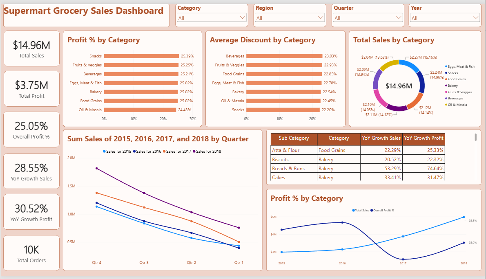

# Supermart-Grocery-Sales — Power BI Grocery Sales & Profitability Dashboard

An end-to-end Business Intelligence project built with Microsoft Power BI on a
Tamil Nadu grocery retail dataset of 9,994 orders (Jan 2015 – Dec 2018). The
project covers data preparation in Power Query, star-schema data modeling, 18
DAX measures, and an executive dashboard delivering insights on revenue,
profitability, discount behaviour, regional coverage, and sub-category
performance.


---

## Dataset Overview

| Attribute | Value |
|---|---|
| Orders | 9,994 |
| Unique customers | 50 |
| Period | 3 Jan 2015 – 30 Dec 2018 |
| Gross revenue | ₹19.52M |
| Net revenue | ₹14.96M |
| Total discount | ₹4.57M (23.4% of gross) |
| Total profit | ₹3.75M |
| Overall profit margin | 25.05% |
| Average order value | ₹1,497 |
| Product categories | 7 |
| Sub categories | 23 |
| Cities | 24 |
| Regions | 5 |
| States | 1 (Tamil Nadu only) |

## Project Scope

1. **Data preparation (Power Query)** — parsed `Order Date` from `M/d/yyyy`
   using the English (United States) locale to avoid day/month inversion,
   cast `Sales` to whole number and `Discount` / `Profit` to decimal, verified
   zero nulls and zero duplicate `Order ID`, and derived a `Gross Sales`
   column as `Sales / (1 - Discount)` to recover pre-discount value.
2. **Data modeling (Power BI)** — star schema with a dedicated `DimDate`
   calendar table marked as date table, joined one-to-many to the fact table
   on `DimDate[Date] → Sales[Order Date]`, with `Month` and `Quarter` sorted
   by their numeric helper columns.
3. **DAX measures** — 18 measures covering core metrics, time intelligence
   (previous-year comparison, YTD, MoM, 3-month rolling average), share and
   ranking, discount analysis, and data-quality checks.
4. **Dashboard** — 6 KPI cards, quarterly trend comparison across four years,
   category and regional breakdowns, a Top 5 sub-category table with YoY
   growth, and a dual-axis sales-vs-margin view by year.

## Key Findings

- Sales grew from ₹2.98M in 2015 to ₹4.98M in 2018, a CAGR of 18.7%, with the
  steepest jump in 2018 (+28.6% YoY).
- Regional coverage is heavily skewed: West, East, Central and South account
  for 99.99% of revenue, while **North holds a single transaction** (₹1,254).
  Flagged as a coverage gap rather than a genuine market signal.
- Discount depth shows no relationship with realised margin — the correlation
  between `Discount` and per-order profit ratio is 0.008. Discounting in this
  dataset is not a margin lever, which is itself the finding.
- Demand is almost flat across the seven categories (13.6%–15.2% share each),
  so category mix is not a differentiator; the actionable variance sits one
  level down, at sub-category.
- Health Drinks and Soft Drinks lead on profit (₹267K and ₹258K), together
  contributing 14.0% of total profit from only two of 23 sub categories.
- Customer base is unusually concentrated: 50 customers averaging 200 orders
  each, which makes customer-level segmentation unproductive on this dataset.

## DAX Measures (18)

| Measure | Formula | Purpose |
|---|---|---|
| Total Sales | `SUM(Sales[Sales])` | Net revenue after discount |
| Total Gross Sales | `SUMX(Sales, DIVIDE(Sales[Sales], 1 - Sales[Discount]))` | Transaction value before discount |
| Total Discount Value | `[Total Gross Sales] - [Total Sales]` | Absolute discount given, in currency |
| Total Profit | `SUM(Sales[Profit])` | Total profit across orders |
| Overall Profit % | `DIVIDE([Total Profit], [Total Sales])` | Profit margin on net revenue |
| Total Orders | `DISTINCTCOUNT(Sales[Order ID])` | Number of unique orders |
| Total Customers | `DISTINCTCOUNT(Sales[Customer Name])` | Number of unique customers |
| AOV | `DIVIDE([Total Sales], [Total Orders])` | Average net value per order |
| Avg Profit per Order | `DIVIDE([Total Profit], [Total Orders])` | Average profit contribution per order |
| Avg Discount % | `AVERAGE(Sales[Discount])` | Mean discount rate applied per order |
| Discount Rate % | `DIVIDE([Total Discount Value], [Total Gross Sales])` | Discount as a proportion of gross sales |
| PY Sales | `CALCULATE([Total Sales], SAMEPERIODLASTYEAR(DimDate[Date]))` | Prior-year sales in the matching period |
| YoY Growth Sales % | `DIVIDE([Total Sales] - [PY Sales], [PY Sales])` | Year-over-year revenue growth |
| YoY Growth Profit % | `DIVIDE([Total Profit] - CALCULATE([Total Profit], SAMEPERIODLASTYEAR(DimDate[Date])), CALCULATE([Total Profit], SAMEPERIODLASTYEAR(DimDate[Date])))` | Year-over-year profit growth |
| Sales YTD | `TOTALYTD([Total Sales], DimDate[Date])` | Cumulative sales from the start of the year |
| Sales MoM % | `DIVIDE([Total Sales] - CALCULATE([Total Sales], PREVIOUSMONTH(DimDate[Date])), CALCULATE([Total Sales], PREVIOUSMONTH(DimDate[Date])))` | Month-over-month growth rate |
| Sales 3M Avg | `AVERAGEX(DATESINPERIOD(DimDate[Date], MAX(DimDate[Date]), -3, MONTH), [Total Sales])` | Three-month rolling average, smooths monthly volatility |
| % of Total Sales | `DIVIDE([Total Sales], CALCULATE([Total Sales], ALLSELECTED(Sales[Category])))` | Each category's share of total sales |
| Sub Category Rank | `RANKX(ALLSELECTED(Sales[Sub Category]), [Total Profit], , DESC, DENSE)` | Sub-category ranking by profit, used for Top N filtering |
| Single-Order Regions | `CALCULATE(DISTINCTCOUNT(Sales[Region]), FILTER(VALUES(Sales[Region]), [Total Orders] = 1))` | Data-quality check: regions represented by one transaction only (North) |

> Card-context variants of the two YoY measures resolve the latest year against
> the one before it, so the KPI tiles report 2018 vs 2017 without needing a year
> on the visual.

## Dashboard Components

| Section | Visual | Fields |
|---|---|---|
| Filters | Slicer (tile) | `Category` |
| Filters | Slicer (dropdown) | `Region`, `DimDate[Quarter]`, `DimDate[Year]` |
| KPI column | 6 × Card | Total Sales, Total Profit, Overall Profit %, YoY Growth Sales %, YoY Growth Profit %, Total Orders |
| Composition | Donut | `Category` × `[Total Sales]` |
| Composition | Clustered bar | `Category` × `[Overall Profit %]` |
| Composition | Clustered bar | `Category` × `[Avg Discount %]` |
| Trend | Line chart | X `DimDate[Quarter]`, legend `DimDate[Year]`, value `[Total Sales]` |
| Ranking | Table (Top 5 filter) | `Sub Category`, `Category`, `[Total Profit]`, YoY growth measures |
| Trend | Line and stacked column | X `DimDate[Year]`, column `[Total Sales]`, line `[Overall Profit %]` |

Profit percentage and average discount are shown as bar charts rather than
donuts: both are ratios, and a donut implies the slices sum to a meaningful
whole, which ratios do not.

## Repository Structure

```
.
├── data/
│   └── Supermart_Grocery_Sales.csv
├── pbix/
│   └── SupermartIQ.pbix
├── docs/
│   ├── measures.md
│   └── dashboard.png
└── README.md
```

## How to Reproduce

1. Open `pbix/SupermartIQ.pbix` in Power BI Desktop (May 2024 release or later).
2. If the source path breaks, go to Transform data → Data source settings and
   repoint the CSV to your local `data/` folder.
3. Confirm the model loads correctly: with no filters applied, `Total Sales`
   must read **14,956,982**. Any other figure points to a date-parsing issue
   at import.
4. Refresh.

## Known Limitations

- `State` contains a single value (Tamil Nadu), so geographic analysis is
  limited to city and region level.
- The dataset has no quantity column, so unit economics, basket size, and
  price-per-unit analysis are out of scope. Order count is used as the volume
  metric throughout.
- Profit is supplied as a given field, not derived from cost, so margin cannot
  be decomposed into cost drivers.
- Per-order profit ratio is uniformly distributed between 5% and 45%, which
  suggests the profit column is synthetic. Conclusions about profitability
  should be read as demonstrations of method rather than market insight.

## Tools

Power BI Desktop · Power Query (M) · DAX · star-schema modeling
